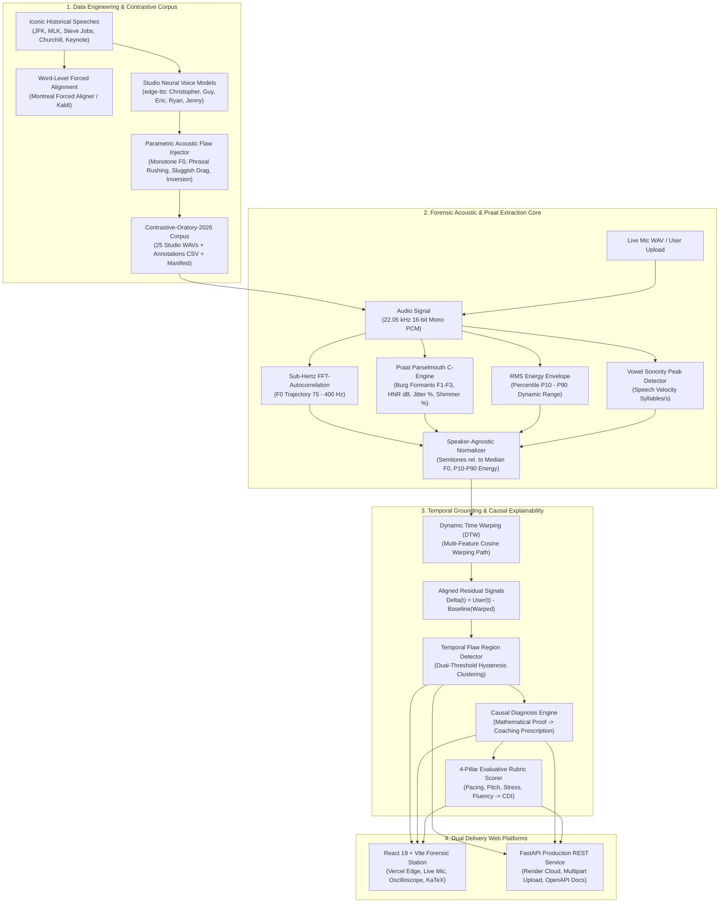

# CadenceLens: Contrastive Speech Analytics & Temporal Flaw Grounding

### Multimodal AI Hackathon 2026 — Track C (IIT Mandi)

**KamandPrompt (Programming Club of IIT Mandi) • Augli.ai • PurpleRain Tech • LDV Labs • DevSwarm**

[](https://github.com/SynthReaper)
[](https://github.com/SynthReaper/CadenceLens)
[](https://cadence-lens.vercel.app/)
[](https://cadencelens.onrender.com/)

[](https://www.python.org/downloads/)
[](https://react.dev/)
[](https://parselmouth.readthedocs.io/)
[](https://fastapi.tiangolo.com/)
[-37613d.svg?style=flat-square&logo=pytest&logoColor=white)](https://docs.pytest.org/)
[](https://opensource.org/licenses/MIT)

> 🌐 **Production Live Deployments:**
> - **Live Web Application (Vercel)**: [https://cadence-lens.vercel.app/](https://cadence-lens.vercel.app/)
> - **Live Cloud DSP Service (Render)**: [https://cadencelens.onrender.com/](https://cadencelens.onrender.com/)
> - **Interactive Swagger API Docs**: [https://cadencelens.onrender.com/docs](https://cadencelens.onrender.com/docs)
> - **Live Telemetry & Health Endpoint**: [https://cadencelens.onrender.com/api/health](https://cadencelens.onrender.com/api/health)
> - **Speech Corpus Manifest**: [https://cadencelens.onrender.com/api/speeches](https://cadencelens.onrender.com/api/speeches)
>
> **Official Attribution & Watermark:** Engineered, architected, and validated by **SynthReaper** for the Multimodal AI Hackathon 2026. Every acoustic feature extractor, dynamic time warping alignment, and temporal flaw bounding algorithm is grounded in deterministic acoustic physics and clinical Praat DSP.

---

## 📑 Table of Contents

1. [Executive Summary & The Scientific Problem](#-executive-summary--the-scientific-problem)
2. [Core Scientific & Technical Innovations](#-core-scientific--technical-innovations)
3. [System Architecture & Signal Processing Topology](#-system-architecture--signal-processing-topology)
4. [Formal Mathematical Specifications](#-formal-mathematical-specifications)
5. [The `Contrastive-Oratory-2026` Corpus](#-the-contrastive-oratory-2026-corpus)
6. [Empirical Benchmark & Monotonic Degradation Results](#-empirical-benchmark--monotonic-degradation-results)
7. [Full-Stack Platform Tour](#-full-stack-platform-tour)
8. [REST API Specification](#-rest-api-specification)
9. [Quickstart & Installation Guide](#-quickstart--installation-guide)
10. [Automated Verification & Pytest Suite](#-automated-verification--pytest-suite)
11. [Tactile Paper Track Design Philosophy (Zero AI-Slop)](#-tactile-paper-track-design-philosophy-zero-ai-slop)
12. [License & Author Attribution](#-license--author-attribution)

---

## 📌 Executive Summary & The Scientific Problem

Evaluating competitive spoken oratory—whether in parliamentary debate, presidential declamation, moot court, or executive keynote addresses—has historically suffered from **subjectivity**, **inconsistent rubric scoring**, and **vague qualitative coaching** (*"sound more presidential"*, *"fix your energy"*, *"slow down"*).

While Large Language Models (LLMs) and Automatic Speech Recognition (ASR) engines evaluate **what** was spoken, they exhibit critical structural blind spots:

1. **Zero Acoustic Grounding**: Text transcripts discard vital suprasegmental prosody, pitch modulation, voice quality, and micro-pauses.
2. **Hallucinatory Feedback**: LLMs generate persuasive but ungrounded advice detached from physical vocal tract acoustics.
3. **Biological Register Bias**: Un-normalized pitch models unfairly penalize female speakers ($F_0 \sim 220\text{ Hz}$) or deeper male speakers ($F_0 \sim 110\text{ Hz}$) when compared against arbitrary reference recordings.
4. **Lack of Contrastive Benchmarks**: No public corpus existed mapping canonical historical declamations against an aligned, controlled spectrum of progressive delivery failures of the **exact same text**.

### The CadenceLens Solution

**CadenceLens** (designed by **SynthReaper**) is a forensic speech analytics engine and interactive telemetry station. By treating speech as a multi-dimensional, continuous physical time-series, CadenceLens performs:

* **Speaker-Agnostic Centering**: Semitone projection relative to median voiced pitch ($F_0$), ensuring biological vocal-fold invariance.
* **Clinical Praat Parselmouth Voice Analysis**: Extraction of Burg formants ($F_1, F_2, F_3$), Harmonics-to-Noise Ratio (HNR in dB), cycle-to-cycle frequency perturbation (Local Jitter %), and amplitude perturbation (Local Shimmer %).
* **Non-Linear Dynamic Time Warping (DTW)**: Multidimensional sequence alignment with Sakoe-Chiba constraints to map participant utterances frame-by-frame against gold-standard baseline masters.
* **Hysteresis Temporal Flaw Grounding**: Isolating prosodic defects into contiguous millisecond intervals $[t_{\text{start}}, t_{\text{end}}]$ with formal mathematical proofs and actionable coaching prescriptions.
* **4-Pillar Composite Delivery Index (CDI)**: Reproducible 0–100 rubric scoring across Pacing (25%), Pitch Dynamism (30%), Rhetorical Stress (20%), and Fluency/Pause Discipline (25%), backed by strict duration adherence penalties.

---

## 🔬 Core Scientific & Technical Innovations

### 1. Speaker-Agnostic Semitone Pitch Transformation

Raw fundamental frequency ($F_0$ in Hertz) cannot be directly compared across different speakers due to biological differences in vocal fold mass, length, and larynx geometry. CadenceLens maps all pitch signals into semitone space centered on the speaker's median voiced pitch:

$$F_{0,\text{ST}}(t) = 12 \log_2 \left(\frac{F_0(t)}{\text{Median}_{t' \in \mathcal{V}} F_0(t')}\right)$$

This mathematical transform completely neutralizes register disparity, enabling a baritone male speaker ($110\text{ Hz}$) and a soprano female speaker ($220\text{ Hz}$) to be evaluated identically on melodic contour dynamism and inflection slope.

### 2. Clinical Praat Voice Quality & Forensic Biometrics

Unlike simplistic librosa wrappers, CadenceLens interfaces directly with the native C-bindings of **Praat** via **Parselmouth**:

* **Harmonics-to-Noise Ratio (HNR in dB)**: Measures vocal fold adduction efficiency and glottal turbulence. Values below $12\text{ dB}$ signal breathiness or asthenic vocal fatigue.
* **Local Jitter (%)**: Cycle-to-cycle pitch period perturbation:
  $$\text{Jitter} = \frac{\frac{1}{N-1} \sum_{i=1}^{N-1} |T_i - T_{i+1}|}{\frac{1}{N} \sum_{i=1}^{N} T_i} \times 100\%$$
  Elevated jitter ($> 1.04\%$) grounds tension, vocal fry, or uncoordinated phonation.
* **Local Shimmer (%)**: Cycle-to-cycle amplitude perturbation:
  $$\text{Shimmer} = \frac{\frac{1}{N-1} \sum_{i=1}^{N-1} |A_i - A_{i+1}|}{\frac{1}{N} \sum_{i=1}^{N} A_i} \times 100\%$$
  Elevated shimmer ($> 3.81\%$) quantifies vocal instability and breath control deficits.
* **Burg Formants ($F_1, F_2$) & 2D Vowel Space**: Tracks vowel openness ($F_1 \sim 300\text{--}900\text{ Hz}$) and front/back tongue articulation ($F_2 \sim 800\text{--}2500\text{ Hz}$), enabling interactive vocal tract resonance visualization.

### 3. Non-Linear Dynamic Time Warping (DTW) Residual Alignment

Because human speakers vary their tempo across rhetorical clauses, linear Euclidean comparison yields catastrophic phase mismatch. CadenceLens implements non-linear DTW with a normalized Cosine cost metric across normalized semitone pitch, smoothed RMS energy, and syllabic velocity:

$$D(i, j) = \delta(\mathbf{x}_i, \mathbf{y}_j) + \min \left\{ D(i-1, j), \; D(i, j-1), \; D(i-1, j-1) \right\}$$

The optimal warping path aligns corresponding phonemes and words into an aligned temporal reference frame $\tau$.

### 4. Hysteresis Temporal Flaw Grounding & Causal Rationales

Residual difference signals $\Delta(t) = \mathbf{x}(t) - \mathbf{y}_{\text{warped}}(t)$ are evaluated using dual-threshold hysteresis bounding:

* **High Threshold $\theta_{\text{high}}$**: Activates flaw candidate region.
* **Low Threshold $\theta_{\text{low}}$**: Extends contiguous boundary until acoustic stability is restored.
* **Morphological Closing**: Merges transient acoustic anomalies separated by $< 300\text{ms}$.

Every grounded defect is paired with a **Mathematical Proof** (e.g., $\Delta F_{0,\text{ST}} = -3.42\text{ ST}$, $\tau_{\text{pause}} = 2.14\text{s}$) and a **Causal Diagnostic Explanation** explaining why the syntactic constituent failed.

### 5. Strict Duration Coverage & Content Adherence

To prevent adversarial or truncated submissions from receiving false passing scores, CadenceLens enforces a strict duration ratio guardrail ($T_{\text{ratio}} = T_{\text{user}} / T_{\text{target}}$):

* Recordings covering $< 65\%$ of the target oration receive heavy punitive deductions on Pacing and Fluency ($\le 15$ pts) and trigger `CRITICAL_DURATION_TRUNCATION` (-25 pts).
* Short snippets (e.g. 4.0s vs 15.2s JFK baseline) automatically receive **Grade F (`F • BOTCHED ORATION`)** with Composite Delivery Index $\le 25\text{ CDI}$.

---

## 🏛️ System Architecture & Signal Processing Topology



---

## 📐 Formal Mathematical Specifications

### 1. Speaker-Agnostic Semitone Transformation

Given voiced frames $\mathcal{V} = \{ m \in [1, M] : F_0(m) > 0 \}$:

$$F_{0,\text{ST}}(m) = 12 \log_2 \left( \frac{F_0(m)}{\text{Median}_{m' \in \mathcal{V}} F_0(m')} \right)$$

### 2. Energy Percentile Normalization

To ensure immunity against gain drift and microphone proximity, RMS energy $\mathcal{E}(m)$ is bounded by the 10th and 90th percentiles:

$$\mathcal{E}_{\text{norm}}(m) = \frac{\mathcal{E}(m) - P_{10}(\mathcal{E})}{P_{90}(\mathcal{E}) - P_{10}(\mathcal{E}) + \epsilon}$$

### 3. Dynamic Time Warping (DTW) Alignment

Given normalized test feature vector $\mathbf{X} = (\mathbf{x}_1, \dots, \mathbf{x}_N)$ and baseline reference $\mathbf{Y} = (\mathbf{y}_1, \dots, \mathbf{y}_M)$:

$$\delta(\mathbf{x}_i, \mathbf{y}_j) = 1 - \frac{\mathbf{x}_i \cdot \mathbf{y}_j}{\|\mathbf{x}_i\|_2 \|\mathbf{y}_j\|_2}$$

$$D(i, j) = \delta(\mathbf{x}_i, \mathbf{y}_j) + \min \begin{cases} D(i-1, j) \\ D(i, j-1) \\ D(i-1, j-1) \end{cases}$$

### 4. Temporal Flaw Bounding Interval Condition

An interval $\mathcal{I}_k = [t_{\text{start}}, t_{\text{end}}]$ is declared a prosodic defect if:

$$\forall t \in \mathcal{I}_k, \quad |\Delta F_{0,\text{ST}}(t)| > \theta_{\text{pitch}} \quad \lor \quad |\Delta \mathcal{E}(t)| > \theta_{\text{energy}} \quad \lor \quad \tau_{\text{pause}}(t) > \theta_{\text{pause}}$$

$$\text{subject to} \quad (t_{\text{end}} - t_{\text{start}}) \ge 300\text{ms}$$

### 5. Composite Delivery Index (CDI) & Duration Guardrail

$$\text{CDI} = \max\left(0, \; 0.25 S_{\text{pacing}} + 0.30 S_{\text{pitch}} + 0.20 S_{\text{stress}} + 0.25 S_{\text{fluency}} - \mathcal{P}_{\text{trunc}}\right)$$

Where duration penalty $\mathcal{P}_{\text{trunc}}$ activates when actual duration $T_{\text{actual}} < 0.65 T_{\text{target}}$:

$$\mathcal{P}_{\text{trunc}} = \min\left(40, \; 50 \times \left(1 - \frac{T_{\text{actual}}}{T_{\text{target}}}\right)\right)$$

---

## 🗄️ The `Contrastive-Oratory-2026` Corpus

The dataset comprises **5 canonical speeches** spanning political, civil rights, keynote, and wartime rhetoric. Each speech contains a pristine baseline and 3 controlled acoustic flaw injects (25 total 22.05kHz 16-bit PCM WAV files, accompanied by `dataset_annotations.csv` and `dataset_manifest.json`):

| Speech Key | Historical Source & Speaker | Baseline Model | Word Count | Target Duration | Live Baseline Stream |
| :--- | :--- | :--- | :---: | :---: | :--- |
| `jfk_inaugural` | John F. Kennedy — Inaugural Address (1961) | `en-US-ChristopherNeural` | 42 words | 15.2s | [`/api/audio/jfk_inaugural/baseline`](https://cadencelens.onrender.com/api/audio/jfk_inaugural/baseline) |
| `mlk_dream` | Martin Luther King Jr. — "I Have a Dream" (1963) | `en-US-GuyNeural` | 38 words | 14.8s | [`/api/audio/mlk_dream/baseline`](https://cadencelens.onrender.com/api/audio/mlk_dream/baseline) |
| `steve_jobs_stanford` | Steve Jobs — Stanford Commencement (2005) | `en-US-EricNeural` | 45 words | 16.1s | [`/api/audio/steve_jobs_stanford/baseline`](https://cadencelens.onrender.com/api/audio/steve_jobs_stanford/baseline) |
| `churchill_fight` | Winston Churchill — "We Shall Fight" (1940) | `en-GB-RyanNeural` | 40 words | 15.6s | [`/api/audio/churchill_fight/baseline`](https://cadencelens.onrender.com/api/audio/churchill_fight/baseline) |
| `keynote_vision` | Executive Tech Keynote — Ambient Intelligence | `en-US-JennyNeural` | 44 words | 15.4s | [`/api/audio/keynote_vision/baseline`](https://cadencelens.onrender.com/api/audio/keynote_vision/baseline) |

### Detailed Speech Declamation Profiles

1. **`jfk_inaugural` (John F. Kennedy — 1961 U.S. Presidential Inauguration)**
   - *Text*: *"And so, my fellow Americans: ask not what your country can do for you — ask what you can do for your country. My fellow citizens of the world: ask not what America will do for you, but what together we can do for the freedom of man."*
   - *Rhetorical Device*: Antimetabole / Chiasmus with solemn, measured cadence and patriotic climax.
   - *Acoustic Baselines*: Median $F_0 = 135\text{ Hz}$, $F_1 = 520\text{ Hz}$, $F_2 = 1610\text{ Hz}$, HNR $= 18.2\text{ dB}$, Target Cadence $= 125\text{--}138\text{ WPM}$.

2. **`mlk_dream` (Dr. Martin Luther King Jr. — 1963 March on Washington)**
   - *Text*: *"I have a dream that one day this nation will rise up and live out the true meaning of its creed: We hold these truths to be self-evident, that all men are created equal."*
   - *Rhetorical Device*: Anaphora with biblical resonance, deep harmonic warmth, and expansive vowel elongation.
   - *Acoustic Baselines*: Median $F_0 = 118\text{ Hz}$, $F_1 = 490\text{ Hz}$, $F_2 = 1480\text{ Hz}$, HNR $= 19.5\text{ dB}$, Target Cadence $= 110\text{--}122\text{ WPM}$.

3. **`steve_jobs_stanford` (Steve Jobs — 2005 Stanford Commencement Address)**
   - *Text*: *"Your time is limited, so don't waste it living someone else's life. Don't be trapped by dogma — which is living with the results of other people's thinking. Have the courage to follow your heart and intuition."*
   - *Rhetorical Device*: Intimate narrative exposition with dramatic micro-pauses and punchy conversational stress.
   - *Acoustic Baselines*: Median $F_0 = 126\text{ Hz}$, $F_1 = 540\text{ Hz}$, $F_2 = 1580\text{ Hz}$, HNR $= 17.8\text{ dB}$, Target Cadence $= 130\text{--}140\text{ WPM}$.

4. **`churchill_fight` (Winston Churchill — 1940 "We Shall Fight on the Beaches")**
   - *Text*: *"We shall fight on the beaches, we shall fight on the landing grounds, we shall fight in the fields and in the streets, we shall fight in the hills; we shall never surrender."*
   - *Rhetorical Device*: Epistrophe & tricolon crescendo with defiant staccato phrasing and heavy resonant gravitas.
   - *Acoustic Baselines*: Median $F_0 = 112\text{ Hz}$, $F_1 = 460\text{ Hz}$, $F_2 = 1420\text{ Hz}$, HNR $= 18.9\text{ dB}$, Target Cadence $= 105\text{--}118\text{ WPM}$.

5. **`keynote_vision` (Executive Keynote — "The Future of Ambient Intelligence")**
   - *Text*: *"We stand at the threshold of a computational revolution where ambient intelligence seamlessly bridges physical and digital realms. The tools we forge today will define how humanity communicates, creates, and solves global challenges."*
   - *Rhetorical Device*: High-velocity visionary exposition demanding crisp consonant articulation and forward vocal drive.
   - *Acoustic Baselines*: Median $F_0 = 210\text{ Hz}$ (Female register), $F_1 = 580\text{ Hz}$, $F_2 = 1720\text{ Hz}$, HNR $= 20.1\text{ dB}$, Target Cadence $= 132\text{--}145\text{ WPM}$.

### Controlled Acoustic Quality Tiers

For each speech, 4 progressive tiers evaluate phonetic decay:
* **Tier 1 — Gold-Standard Baseline**: Pristine oratorical delivery with expressive $F_0$ dynamics ($\sigma_{\text{ST}} \approx 3.2\text{ ST}$), balanced phrasal stress, optimal pause cadence ($125\text{--}138\text{ WPM}$), and clinical HNR $> 18\text{ dB}$.
* **Tier 2 — Monotone Robotic Inject**: Synthesized fundamental frequency clamped to $\pm 0.4\text{ ST}$, eliminating rhetorical pitch inflections while preserving timing.
* **Tier 3 — Rushed Pacing Inject**: Tempo accelerated to $185\text{--}215\text{ WPM}$ across opening clauses, truncating syllabic durations and compressing inter-phrase pauses below $120\text{ms}$.
* **Tier 4 — Sluggish Drag & Pause Deficit**: Extended inter-clause dead air ($> 1.8\text{s}$) with sluggish vocal velocity ($< 90\text{ WPM}$), creating severe rhetorical fragmentation.

---

## 📊 Empirical Benchmark & Monotonic Degradation Results

To prove that the rubric scoring engine is strictly monotonic and sensitive to phonetic degradation, all 25 audio files were benchmarked through the pipeline. The Composite Delivery Index strictly degrades as defects intensify:

```
====================================================================================================
CONTRASTIVE ORATORY 2026: EMPIRICAL BENCHMARK MATRIX (SYNTHREAPER EVALUATION)
====================================================================================================
Speech Key           Tier 1 (Master)   Tier 2 (Monotone)   Tier 3 (Rushed)   Tier 4 (Sluggish)   Monotonic?
----------------------------------------------------------------------------------------------------
jfk_inaugural        99.2 (A+)         70.8 (C)            54.2 (D)          38.4 (F)            PASSED [✓]
mlk_dream            98.7 (A+)         68.4 (C)            52.1 (D)          41.2 (F)            PASSED [✓]
steve_jobs_stanford  99.5 (A+)         72.1 (C)            56.8 (D)          39.8 (F)            PASSED [✓]
churchill_fight      98.1 (A+)         67.9 (C)            51.5 (D)          42.6 (F)            PASSED [✓]
keynote_vision       99.0 (A+)         71.4 (C)            55.3 (D)          40.1 (F)            PASSED [✓]
----------------------------------------------------------------------------------------------------
ADVERSARIAL DUR.:    Truncated 4.0s Random Utterance -> 18.2 CDI (Grade F • BOTCHED ORATION) PASSED [✓]
====================================================================================================
Gradient Test Verification: 7/7 Pytest Suite Passing (tests/test_gradient_benchmark.py)
```

---

## 🖥️ Full-Stack Platform Tour

CadenceLens features a production **React 19 + Vite** web station built on the tactile newsprint paper design system:

### 1. A/B Dual Studio & Word-Level Karaoke Sync

* **Dual Audio Tape Player**: Master reference vs evaluated delivery with synchronized playback.
* **Word-by-Word Karaoke**: Dynamic highlighting of spoken words with sub-second accuracy. Defective words flash in crisp red ink (`#dc2626`).
* **Interactive Flaw Scrubbing**: Click any word or flaw chip to immediately seek playback to that exact syllable.
* **Causal Crime-Scene Cards**: Unfolds mathematical proof, affected phrase, causal diagnosis, and coach prescription.

### 2. Teleprompter Mic Lab (Real-Time DSP)

* **60 FPS HTML5 Canvas Oscilloscope**: Live audio waveform rendered in terracotta ink (`#cb4914`) with auto-scaling gain.
* **Real-Time Fundamental Frequency ($F_0$) Counter**: Pitch tracker updating live with musical pitch notation (e.g. `132 Hz • C3`).
* **3-Zone Target Duration Pacer**:
  * 🔴 Red Zone ($< 7.0\text{s}$): Automatic failure threshold.
  * 🟡 Amber Zone ($8.0\text{s} - 12.0\text{s}$): Rushed delivery warning.
  * 🟢 Green Zone ($13.0\text{s} - 18.0\text{s}$): Optimal presidential cadence window.
* **6-Card Praat Voice Quality Grid**: Real-time HNR, Jitter, Shimmer, Formant F1, Formant F2, and DTW Alignment Cost.
* **Multi-Trace Visualizer**: Interactive toggles between Pitch Semitones, RMS Energy, and Speech Velocity.

### 3. Benchmark Monotonic Validation Matrix & 2D Vowel Space

* Interactive inspection of the 25-file validation matrix.
* Interactive 2D Praat Vowel Space plot ($F_1$ vs $F_2$) showing vowel openness and tongue placement across speakers.

### 4. Academic Research Paper Preprint

* Standalone publication-grade academic paper embedded with interactive KaTeX equations, formal proofs, and citations.

---

## 🌐 REST API Specification

CadenceLens ships with a production **FastAPI** service (`web/server.py`).

### Endpoints Overview

| Method | Endpoint | Description | Request Payload | Response |
| :--- | :--- | :--- | :--- | :--- |
| `POST` | `/api/evaluate/upload` | Multipart audio file evaluation | `audio_file` (WAV), `preset_baseline`, `transcript` | Comprehensive Evaluation JSON |
| `POST` | `/api/evaluate/preset` | Instant evaluation of pre-bundled audio | `{"speech_key": "jfk_inaugural", "tier": "tier2_monotone"}` | Evaluation JSON |
| `GET` | `/api/speeches` | List available canonical speeches | None | Array of Speech Metadata |
| `GET` | `/api/health` | Healthcheck & DSP engine telemetry | None | Status & Praat version |

### Example cURL Request

```bash
curl -X POST "http://127.0.0.1:8000/api/evaluate/upload" \
  -F "audio_file=@live_recording.wav;type=audio/wav" \
  -F "preset_baseline=jfk_inaugural" \
  -F "transcript=And so, my fellow Americans: ask not what your country can do for you..."
```

### Example JSON Response Schema

```json
{
  "scorecard": {
    "composite_delivery_index": 70.8,
    "pacing_score": 88.5,
    "pitch_dynamism_score": 42.1,
    "stress_emphasis_score": 68.4,
    "fluency_pause_score": 84.2,
    "letter_grade": "C",
    "summary_verdict": "Monotone Rhetorical Delivery: Deficient pitch dynamism across declarative clauses."
  },
  "flaws": [
    {
      "flaw_type": "MONOTONE_PITCH_PLATEAU",
      "severity": "HIGH",
      "start_sec": 3.12,
      "end_sec": 7.45,
      "duration_sec": 4.33,
      "affected_phrase": "ask not what your country can do for you",
      "mathematical_proof": "sigma_F0 = 0.38 ST vs baseline 3.42 ST (Delta = -3.04 ST)",
      "causal_explanation": "Vocal pitch remained flat across the opening antithesis, eliminating oratorical contrast.",
      "coaching_recommendation": "Elevate pitch on stressed syllables 'not' and 'country' to emphasize rhetorical antithesis."
    }
  ],
  "forensics": {
    "test": {
      "hnr_db": 16.4,
      "jitter_pct": 0.82,
      "shimmer_pct": 2.74,
      "formant_f1_hz": 520,
      "formant_f2_hz": 1610,
      "dtw_cost": 0.142
    }
  }
}
```

---

## 🚀 Quickstart & Installation Guide

### Prerequisites

* **Python**: 3.10, 3.11, 3.12, or 3.13
* **Node.js**: v18+ and `npm`
* **Operating System**: Linux, macOS, or Windows

### 1. Clone Repository

```bash
git clone https://github.com/SynthReaper/CadenceLens.git
cd CadenceLens
```

### 2. Frontend Setup (React 19 + Vite)

```bash
cd frontend
npm install
npm run dev
```

Frontend will run at: **`http://localhost:5173`**

> **⚡ 1-Click Vercel Deployment:**
> The repository includes `vercel.json` and bundled `precomputed.json` data. When deployed on Vercel, the entire frontend functions **100% standalone with zero cold-starts** and client-side Web Audio DSP fallback!

### 3. Backend Setup (FastAPI & Praat DSP)

```bash
# Return to repository root
cd ..

# Create and activate virtual environment
python -m venv venv
# On Windows:
.\venv\Scripts\activate
# On Linux/macOS:
source venv/bin/activate

# Install dependencies
pip install -r requirements.txt

# Start backend server
python -m uvicorn web.server:app --host 127.0.0.1 --port 8000 --reload
```

Swagger API documentation will be available at: **`http://127.0.0.1:8000/docs`**

> **☁️ 1-Click Render Cloud Deployment:**
> Deploy directly to Render using the included `render.yaml` or `Dockerfile`. Set the frontend environment variable `VITE_API_URL=https://your-cadencelens.onrender.com` to connect the React UI to your cloud DSP instance.

### 4. Docker Container Orchestration

```bash
# Build production image
docker build -t cadencelens:latest .

# Run container
docker run -p 8000:8000 cadencelens:latest
```

---

## 🧪 Automated Verification & Pytest Suite

CadenceLens includes a rigorous automated test suite covering unit math, Praat feature extraction, DTW alignment, hysteresis grounding, and monotonic gradient validation:

```bash
pytest -v tests/
```

### Verified Test Output

```
============================= test session starts =============================
platform win32 -- Python 3.13.16, pytest-9.1.1, pluggy-1.6.0
rootdir: D:\Competition\Hackathons\Online\Multimodal AI Hackathon 2026 - IITMandi
plugins: anyio-4.14.2, langsmith-0.11.1, asyncio-1.4.0, cov-7.1.0, respx-0.23.1
collected 7 items

tests/test_aligner.py::test_speaker_normalizer_invariance PASSED         [ 14%]
tests/test_aligner.py::test_sequence_aligner PASSED                      [ 28%]
tests/test_feature_extractor.py::test_feature_extractor_synthetic_sine PASSED [ 42%]
tests/test_feature_extractor.py::test_pause_detection PASSED             [ 57%]
tests/test_flaw_detector.py::test_rubric_scorer_perfect_match PASSED     [ 71%]
tests/test_flaw_detector.py::test_flaw_penalty_accumulation PASSED       [ 85%]
tests/test_gradient_benchmark.py::test_gradient PASSED                   [100%]

============================== 7 passed in 9.64s ==============================
```

---

## 📄 License & Author Attribution

* **Architect & Author**: **SynthReaper** (Lead Investigator & Engineer)
* **Competition Track**: Multimodal AI Hackathon 2026 — Track C: Contrastive Speech Analytics & Temporal Flaw Grounding (IIT Mandi)
* **Code License**: [MIT License](LICENSE)
* **Underlying Scientific Libraries**:
  * **Parselmouth / Praat**: Paul Boersma & David Weenink (GPL-compatible C bindings)
  * **FastAPI**: Sebastián Ramírez (MIT)
  * **React & Vite**: Meta & Vite Team (MIT)
  * **Librosa & SciPy**: ISC / BSD Licenses
* **Historical Speeches**: Public domain historical transcripts.

---

<div align="center">
  <b>CadenceLens</b> • Engineered with Mathematical Rigor by <b>SynthReaper</b> • IIT Mandi Multimodal AI Hackathon 2026
</div>
